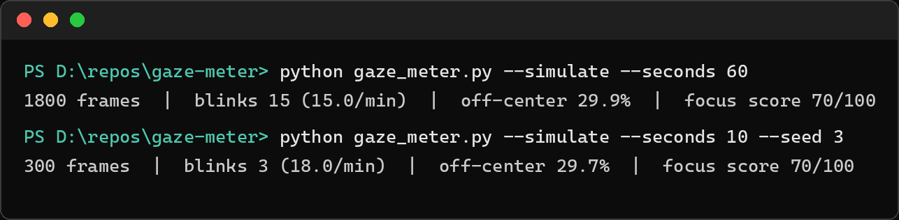

# gaze-meter

[](https://github.com/amanvicky/gaze-meter/actions/workflows/ci.yml)

Attention analytics from a webcam: blinks per minute, how much of the time your gaze left the lens, and a focus score. The measurement half of the OpenBroadcast gaze family — [Open-Broadcast](https://github.com/amanvicky/Open-Broadcast) *corrects* your gaze, this one *scores* it.

```bash
$ python gaze_meter.py --simulate --seconds 60
1800 frames  |  blinks 15 (15.0/min)  |  off-center 29.9%  |  focus score 70/100
```



Every run above is synthetic and deterministic (a blink every 4 s, a look-away for 6 of every 20 frames) — which is why the numbers land right where the pattern says: 15.0 blinks/min and a 30 % look-away pattern read out as 29.9 %. `--simulate` exists so the metrics are testable without a camera, and so you can sanity-check the tool before pointing it at your face.

## Metrics

| Metric | Meaning |
|---|---|
| `blinks/min` | eye-openness dips, counted with hysteresis (below 0.18 = shut, recovery past 0.28 = blink) |
| `off-center %` | share of frames with gaze more than 0.28 eye-widths from the lens |
| `focus score` | 100 minus the off-center share — the time your eyes actually spent near the lens |

Gaze is the iris offset from eye center **normalized by eye width**, so camera distance doesn't matter, and it's smoothed with the same exponential factor (0.35) [openbroadcast-web](https://github.com/amanvicky/openbroadcast-web) uses — same mesh landmarks (478-point face mesh, irises 468/473), same tuning, one consistent story.

## Run

```bash
# camera mode (first run downloads the face model, ~3 MB, cached beside the script)
pip install mediapipe opencv-python
python gaze_meter.py --seconds 300 --csv blinks.csv

# no camera needed
python gaze_meter.py --simulate --seed 7
```

Live mode prints the running counts as it watches, then the per-session summary. `--csv` writes the blink timestamps.

## Why

I wanted numbers instead of vibes about my own attention: how often do I actually blink during a focus block, and how much of a "focused" hour did I really spend looking at the screen? The measurement turned out to be a natural sibling to the correction tool — same landmarks, opposite direction.

## Tests

```bash
pytest tests/ -q
```

Thirteen tests, no camera, no mediapipe: eye-box geometry, normalized gaze, hysteresis blink counting, session math with exact values, determinism of the synthetic session, and an end-to-end simulate run. The core imports with **neither** mediapipe nor opencv installed — the camera deps load lazily, by design. CI runs the suite on every push.
